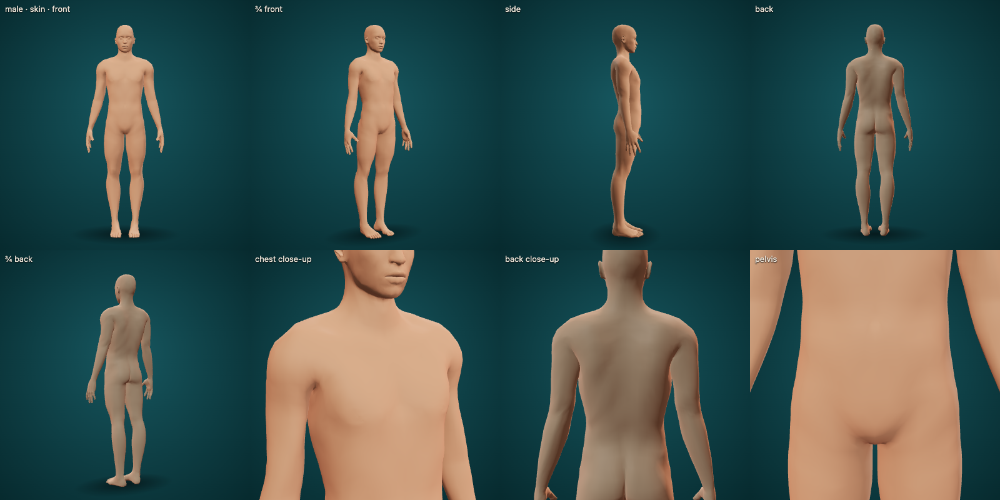
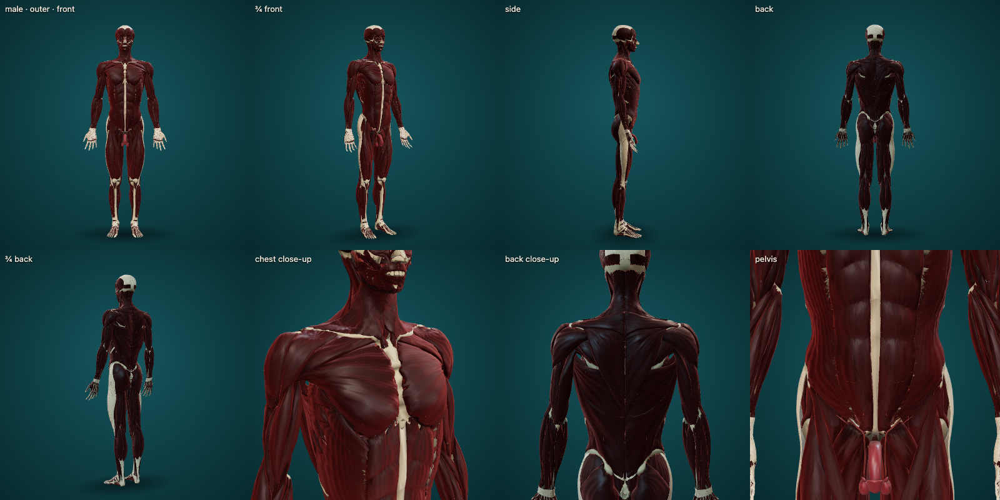
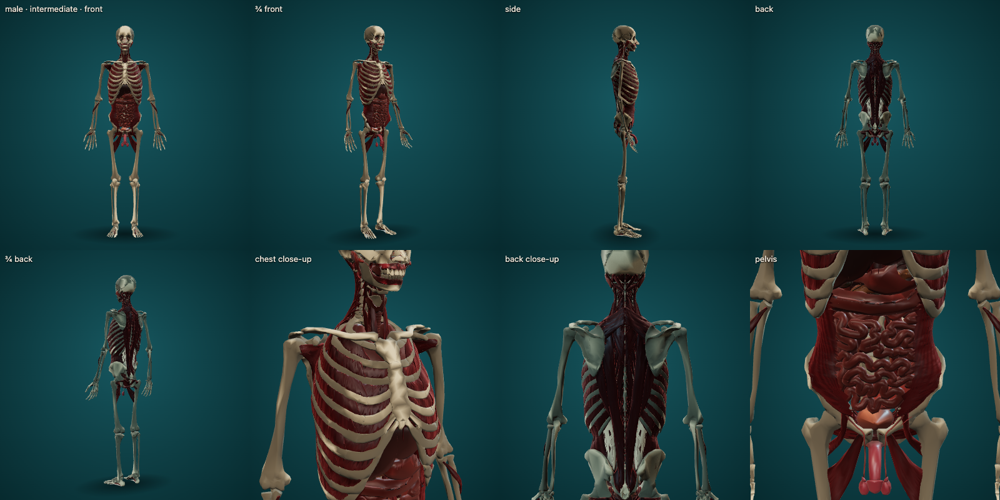
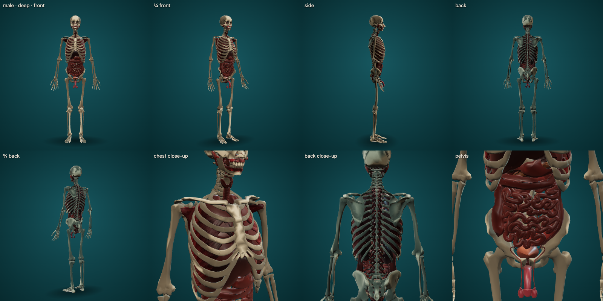
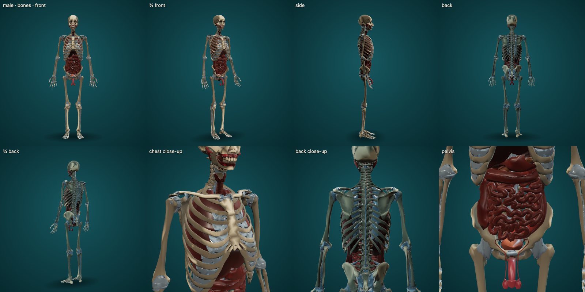
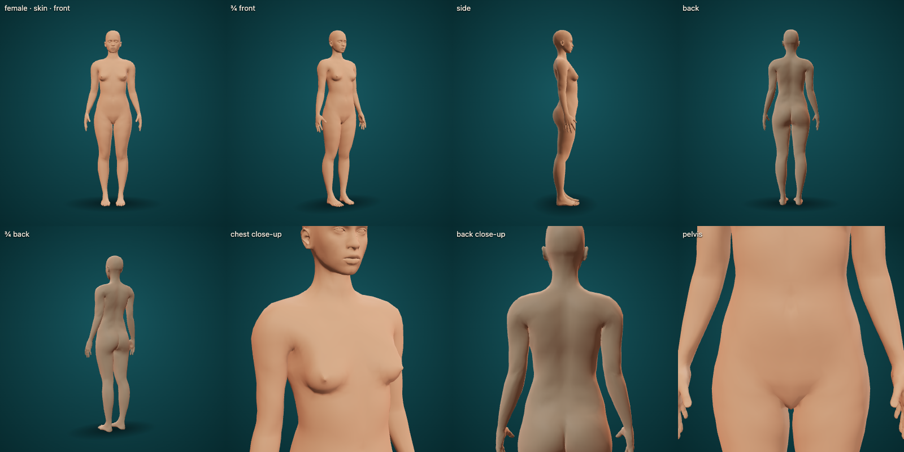
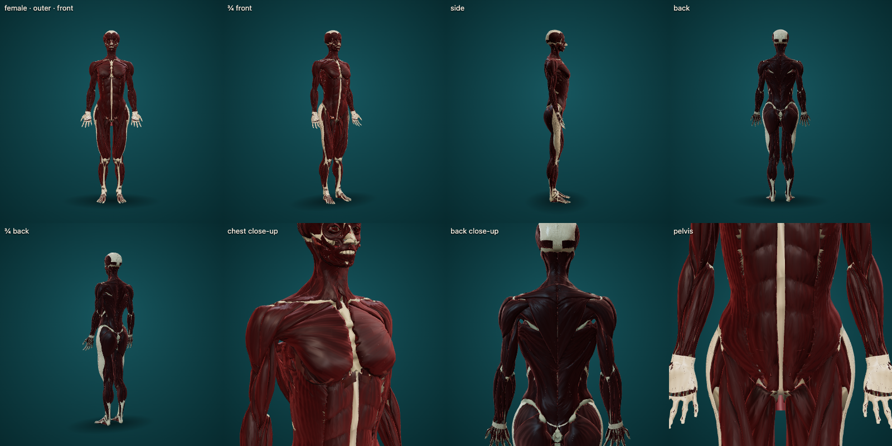
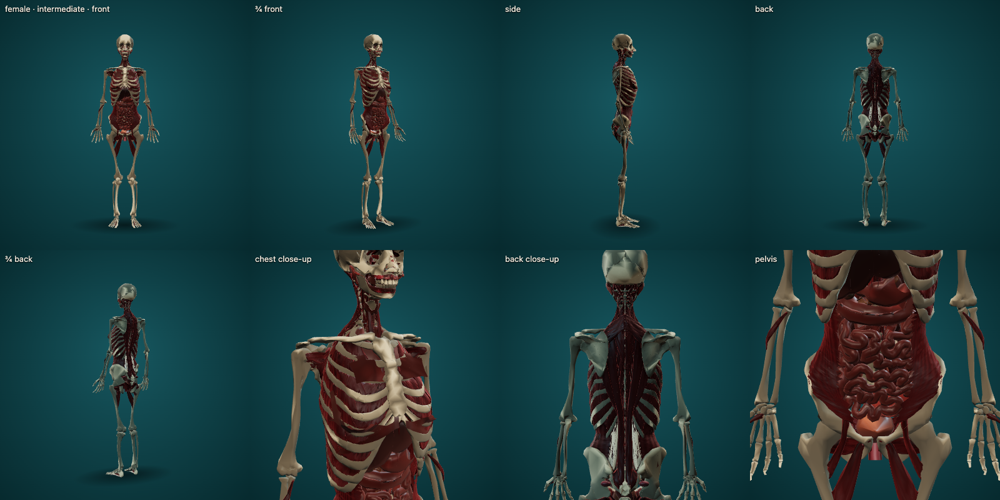
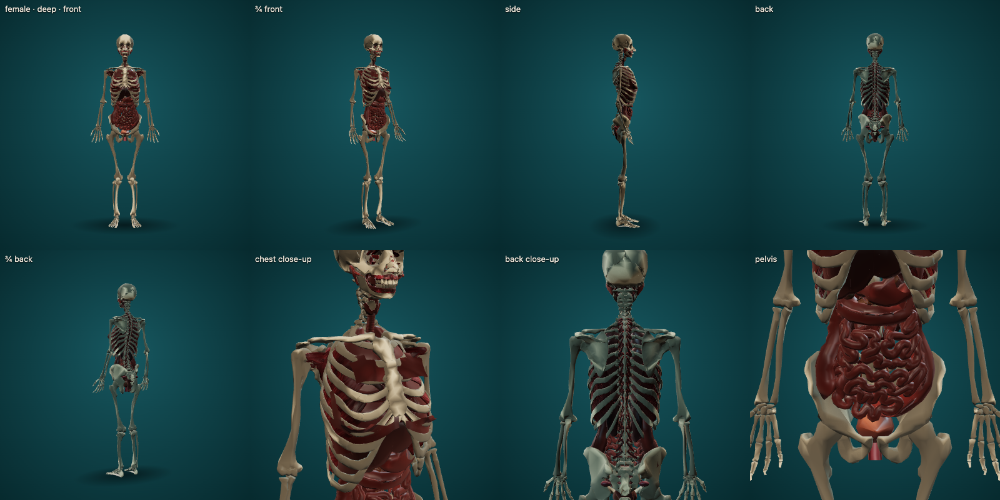
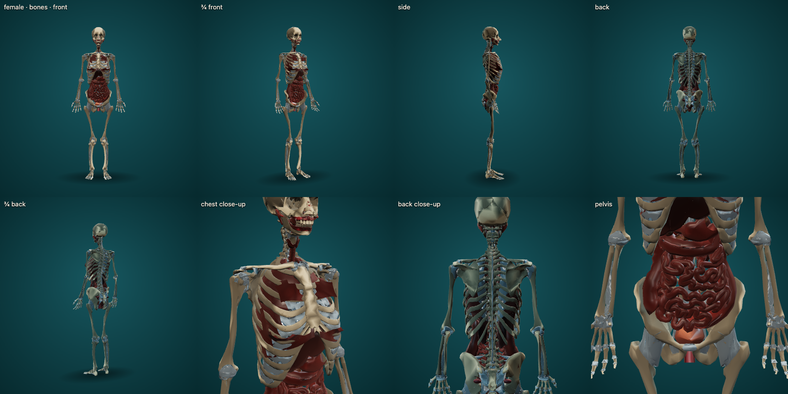

# R1: body data pipeline (report)

Branch `r1-body-pipeline`. Pipeline in `tools/pipeline/v5/`, data in `public/data/body/`. All numbers below are measured (raw/build.log, raw/export.log, manifest.json, layer_review.json, tools/pipeline/cache/sources.json). The app is unchanged.

## 1. Sources

| Source | Commit | Licence | Provides |
|---|---|---|---|
| Z-Anatomy (https://github.com/Z-Anatomy/Models-of-human-anatomy) | `0c86264359f22c3bad3e475a853faf54e23b7948` | CC BY-SA 4.0 | anatomy meshes |
| BodyParts3D (via Z-Anatomy) | same Z-Anatomy commit | CC BY-SA 2.1 JP | original anatomy meshes |
| MakeHuman, MPFB2 (https://github.com/makehumancommunity/mpfb2) | `9de0707fdc88438d7c53a1a2ac7937d9221e2431` | CC0 | skin base mesh, targets, game rig |

Credits are in `public/data/body/credits.json` (name, url, licence, licence url, what it provides, commit).

## 2. Triangles and parts per kind

Sample numbers are the README's (thousands of triangles, rounded). The sample did not record parts per kind; its total is 2,651 parts.

| Kind | Parts | Triangles | Sample triangles (k) | Load |
|---|---|---|---|---|
| skin | 1 | 27,036 | 27k | first |
| muscle | 443 | 401,564 | 418k | first |
| tendon | 39 | 50,332 | 50k | first |
| bone | 277 | 72,074 | 72k | first |
| organ | 140 | 106,811 | 97k | first |
| vessel | 662 | 178,580 | 186k | demand |
| nerve | 580 | 198,217 | 216k | demand |
| lymph | 158 | 37,784 | 38k | demand |
| joint | 349 | 56,406 | 57k | demand |
| total | 2,649 | 1,128,804 | 1,161k (sum) | |

Parts total 2,649 against the sample's 2,651. Male and female share all part ids (one pack, two position sets).

## 3. Pack sizes

| Pack | Raw bytes | gz bytes | Load |
|---|---|---|---|
| skin | 822,546 | 467,520 | first |
| muscle | 10,063,962 | 5,804,239 | first |
| tendon | 1,269,850 | 735,232 | first |
| bone | 1,812,640 | 893,429 | first |
| organ | 2,709,955 | 1,375,622 | first |
| vessel | 4,634,488 | 2,336,896 | demand |
| nerve | 5,196,750 | 2,645,079 | demand |
| lymph | 978,608 | 494,252 | demand |
| joint | 1,463,424 | 707,623 | demand |
| first-load total | 16,678,953 | 9,276,042 | budget 10,000,000 gz |
| all packs | 28,952,223 | 15,459,892 | |

manifest.json: 703,458 bytes (not gzipped; loaded first, so add it to the first-load figure: 9,979,500 bytes). Sample: 29.9 MB raw, 16.1 MB gz for everything; here 29.0 MB raw, 15.5 MB gz.

## 4. Build time

Measured by `npm run pipeline:v5` from cache after fix round 2 (raw/build.log). Export is the one-off Blender step (raw/export.log).

| Step | Seconds |
|---|---|
| export (za_export.py, Blender headless, not cached) | 321.6 |
| makehuman | cached, not timed |
| pose | cached, not timed |
| geom | 1.8 |
| names | 0.0 |
| sex | 4.1 |
| layers | 0.8 |
| ao (per-layer) | 12.8 |
| pack | 2.5 |
| run total from cache | 22.1 |

The sample builds in 30 s after export; this run is 22.1 s after export.

## 5. Heights

| Sex | Height (m) | Test range |
|---|---|---|
| male | 1.7100 | 1.70 to 1.72 |
| female | 1.5667 | 1.54 to 1.62 |

## 6. Contact sheets

1600x800, 8 views each (front, 3/4 front, side, back / 3/4 back, chest close-up, back close-up, pelvis). Notes per sheet are in raw/contact-notes.md.

### male, skin

### male, outer

### male, intermediate

### male, deep

### male, bones

### female, skin

### female, outer

### female, intermediate

### female, deep

### female, bones

## 7. The 30 most doubtful layer assignments

Closest exposure to the 0.16 threshold (one row per part, `.l` and `.r` listed separately). Exposure is the fraction of vertices uncovered in the round the part was assigned. Overrides are proposals, not applied; a part within 0.01 of the threshold could go either way.

| # | Part | Layer | Exposure | Round | Proposed override | Reason |
|---|---|---|---|---|---|---|
| 1 | Radial head of flexor digitorum superficialis.l | 1 | 0.1615 | 1 | layer 2 | lies under the superficial forearm flexors |
| 2 | Radial head of flexor digitorum superficialis.r | 1 | 0.1615 | 1 | layer 2 | lies under the superficial forearm flexors |
| 3 | Rotatores.r | 4 | 0.1619 | 4 | layer 5 | deepest spinal muscle, under multifidus and semispinalis |
| 4 | Rotatores.l | 4 | 0.1632 | 4 | layer 5 | deepest spinal muscle, under multifidus and semispinalis |
| 5 | Mylohyoid muscle.r | 2 | 0.1643 | 2 | none | floor of mouth under the digastric; layer 2 is right |
| 6 | Hyoglossus muscle.l | 6 | 0.1556 | 6 | none | deep tongue/hyoid muscle; layer 6 is right |
| 7 | Hyoglossus muscle.r | 6 | 0.1556 | 6 | none | deep tongue/hyoid muscle; layer 6 is right |
| 8 | Oblique head of adductor hallucis.l | 3 | 0.1652 | 3 | none | under the plantar aponeurosis and flexor tendons; layer 3 is right |
| 9 | Oblique head of adductor hallucis.r | 3 | 0.1652 | 3 | none | under the plantar aponeurosis and flexor tendons; layer 3 is right |
| 10 | Superior rectus muscle.l | 2 | 0.1667 | 2 | none | inside the orbit, not reachable by the skin; keep with the other eye muscles |
| 11 | Superior rectus muscle.r | 2 | 0.1667 | 2 | none | inside the orbit, not reachable by the skin; keep with the other eye muscles |
| 12 | Short head of biceps brachii.l | 1 | 0.1682 | 1 | none | visible belly of the arm; layer 1 is right |
| 13 | Short head of biceps brachii.r | 1 | 0.1682 | 1 | none | visible belly of the arm; layer 1 is right |
| 14 | Diaphragm | 4 | 0.1685 | 4 | none | deep trunk sheet; layer 4 is right |
| 15 | Superior oblique muscle.l | 6 | 0.1500 | 6 | none | inside the orbit, deepest eye muscle; layer 6 is right |
| 16 | Superior oblique muscle.r | 6 | 0.1500 | 6 | none | inside the orbit, deepest eye muscle; layer 6 is right |
| 17 | Mylohyoid muscle.l | 2 | 0.1714 | 2 | none | floor of mouth under the digastric; layer 2 is right |
| 18 | Abductor pollicis longus.l | 1 | 0.1715 | 1 | layer 2 | emerges between the extensors, not on the surface |
| 19 | Abductor pollicis longus.r | 1 | 0.1715 | 1 | layer 2 | emerges between the extensors, not on the surface |
| 20 | Subscapularis muscle.l | 6 | 0.1736 | 6 | layer 5 | under the scapula and serratus anterior; 6 is only the left-over layer |
| 21 | Subscapularis muscle.r | 6 | 0.1736 | 6 | layer 5 | under the scapula and serratus anterior; 6 is only the left-over layer |
| 22 | Extensor indicis.l | 1 | 0.1736 | 1 | layer 2 | deep extensor of the forearm, under the common extensor |
| 23 | Extensor indicis.r | 1 | 0.1736 | 1 | layer 2 | deep extensor of the forearm, under the common extensor |
| 24 | Levator nasolabialis.l | 1 | 0.1739 | 1 | none | superficial facial muscle; layer 1 is right |
| 25 | Levator nasolabialis.r | 1 | 0.1739 | 1 | none | superficial facial muscle; layer 1 is right |
| 26 | Quadratus plantae muscle.l | 3 | 0.1745 | 3 | none | deep sole muscle under flexor digitorum brevis; layer 3 is right |
| 27 | Quadratus plantae muscle.r | 3 | 0.1745 | 3 | none | deep sole muscle under flexor digitorum brevis; layer 3 is right |
| 28 | Iliocostalis lumborum muscle.l | 2 | 0.1746 | 2 | none | erector spinae under the thoracolumbar fascia; layer 2 is right |
| 29 | Iliocostalis lumborum muscle.r | 2 | 0.1746 | 2 | none | erector spinae under the thoracolumbar fascia; layer 2 is right |
| 30 | Transversus thoracis muscle.l | 5 | 0.1762 | 5 | none | inside the chest wall; layer 5 is right |

## 8. Fix rounds

| ID | Problem | Fix | Result |
|---|---|---|---|
| F1 / F1b | AO near its floor on muscle (layer-1 median 0.13, layers 3-6 0.12), backs rendered nearly black | Round 1 left layers.py unchanged: self hits are 3% of hits within 5 cm, so the pass rule was wrong. Round 2: per-layer AO, a muscle/tendon vertex of layer L is occluded only by non-muscle anatomy and muscle/tendon of layer >= L | Pass, judged on vertices visible on each sheet (male front/back): outer 0.98/1.00, intermediate 0.92/0.95, deep 0.58/0.80 (were about 0.12). All-vertex medians stay low (layer 1 median 0.125, layer 3+ 0.122) because buried vertices touch bone |
| F2 | Female pectoralis major took the breast shape | `sex.anatomy_field`: on the chest the skin warp is replaced by a harmonic fill of the smoothed D from the region border (793 vertices) | Pass. Forward shift beyond the sternum 12.2 mm to 5.9 mm |
| F3 | Generated female organs inside-out (0% outward) | generated parts go through `geom.outward()` | Pass. 100% outward; tubes 100% outward per ring (centroid rule wrong for curved tubes) |
| F4 | Breast fat 78/85 vertices, jagged flaps | linear subdivision to >= 400 vertices per side then Taubin smoothing (trimesh `subdivide_loop` moves open borders, not used) | Pass. 894 / 970 vertices, 100% outward |
| F5 | Greater omentum hid the abdomen | `names.HIDDEN = omentum|mesocolon|pleura`, manifest `defaultHidden` flag, sheets skip them | Pass. 4 parts hidden by default |

Real-data bugs fixed in the first full run (PLAN 2b.15): (1) 290 raw triangles that were duplicates back to back or zero-area cancelled the normals; `geom.clean` drops them (before `outward()` and after decimation); (2) `vertex_normals` falls back to the radial direction where the sum cancels; (3) `MALE_ONLY`/`EXTERNAL` matched `testi` inside `intestinal`, now `\btesti` (male-only 26 to 25, ext 18 to 17).

## 9. Decisions (PLAN Changelog)

| When | Decision |
|---|---|
| 2026-11-15 10:55 | Planned without plan mode or a plan-approval stop; user approved running R1 to R7 back to back. |
| 11:10 | Critic round 1: clarifications 1-17 (imports, order, skin part, Dfull/Dlow, placement, height, units, fibre sign, decimation, peel fallback, override matching, heart system, NaN, budget, real-data fixes, contact depth, counts). |
| 11:35 | keep vessel 0.22 / nerve 0.4 (the sample removes 78% / 60%); T4, T6, T7 started early. |
| 11:50 | skin_part takes the parts list; sex.apply names its own generated parts; female organs need an organ named exactly 'Urinary bladder'. |
| 12:00 | body.load_parts reads the npz once (OOM fix); decimate.muscle 0.14 to 0.25 and re-export (muscle 236k vs sample 418k; now 422,672 raw at export, 401,564 after geom clean). |
| 12:20 | Two-pass scale to a posed male height of 1.71 m and feet on y = 0 after posing (one pass gave 1.7222 m, feet at -0.0099). |
| 13:05 | Fix round 1 for F1-F5 (files: layers.py, sex.py, names.py, pack.py, test_output.py, contact/sheet.html). |
| 13:40 | Fix round 2 for F1b (per-layer AO); SPEC step 6 changes; T11 documents defaultHidden and the gaps. |
| 14:05 | F1 closed by visible-vertex AO; per-layer AO kept (all-vertex medians measure buried surfaces). |

Other decisions: unittest instead of pytest (not approved); the peel fallback (top third of remaining parts by exposure, at least 1, when none reaches 0.16) is kept from the sample; `expected_counts.json` is a regression guard written from this build.

## 10. Known gaps

- Male pectoralis major reaches 9 mm past the male skin (anatomy max z 0.126 m vs skin 0.117 m): the MakeHuman skin does not fit the anatomy on the chest.
- Breast fat is partly behind the ribs: 12-17% of its vertices have a rib in front of them on the deep and bones sheets (same cause).
- Limb muscles are mostly layers 1 and 2 (muscles per layer 1-6: 173/144/58/33/11/24, from the T10 review); the intermediate and deep sheets show a bare limb skeleton. Layers 3+ only show trunk muscles. A limb-specific rule or the overrides in section 7 would move this.
- The skin pack holds 5,634 unused helper vertices (19,158 vertices, 13,524 used). They reach y = -0.016 m (male) / -0.022 m (female) and widen the box; the drawn skin is correct. Costs pack bytes only.
- Vite serves `.gz` files with `Content-Encoding: gzip`, so the browser may already have decompressed a pack. R2 must sniff the gzip header (bytes 1f 8b) before using `DecompressionStream`.
- No scrotum on the male and no external genitalia on the female (MakeHuman skin has only a smooth bulge); penis and testes hang free when the skin is off.
- Hands look bony on the outer sheet: intrinsic hand muscles are not layer 1.
- Pre-existing in the M1 pipeline and app: untouched, as planned (BASELINE.md has no failures).

## 11. Doc changes in this commit

- SPEC 1.3: tests line says unittest; step 5 adds the top-third fallback; step 6 describes per-layer AO; step 9 notes the harmonic-filled breast region of the anatomy field.
- SPEC 1A: default-hidden parts use the `defaultHidden` manifest flag.
- FORMAT.md and PLAN (plans/PLAN.md section 4) manifest: `defaultHidden` added.
- docs/PLAN.md R1 row: result line.
