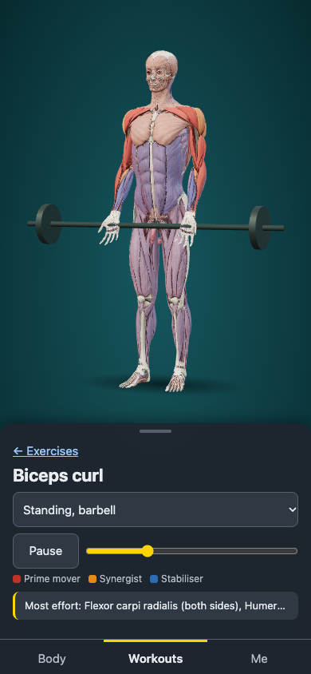
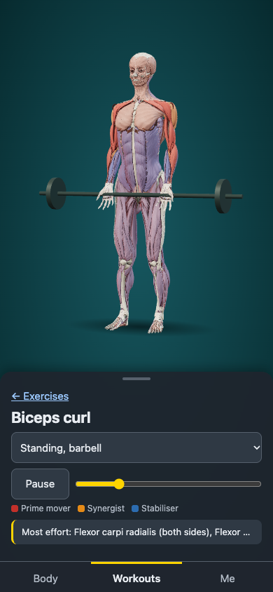
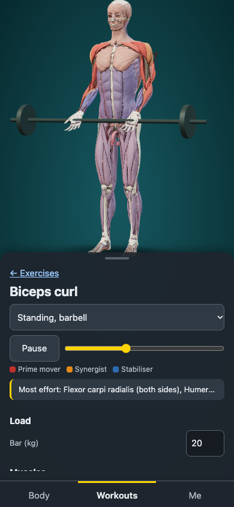
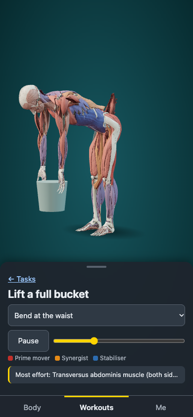
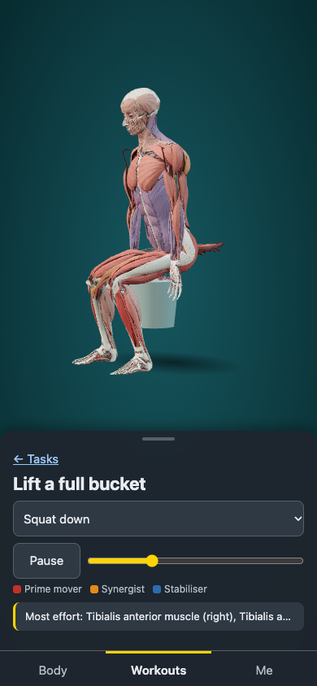
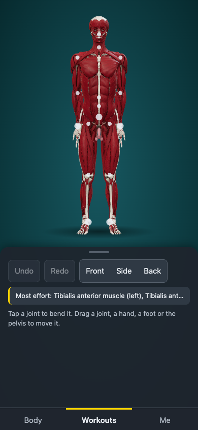
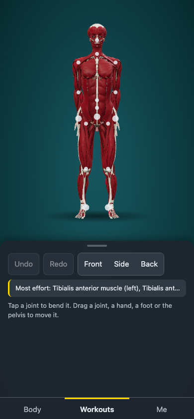

# R4: Effort engine (report)

Branch `r4-effort-engine`. Numbers come from `tools/engine/cases.mjs` (plans/raw/cases.md), plans/raw/measure.md, plans/raw/largest40.md, plans/raw/variants.md and plans/TEST_RESULTS.md (all under docs/done_development/r4-effort-engine/plans/).

## AC status
- AC1 engine pure, six must-pass cases pass for both sexes: **met** (as tests, with two SPEC corrections below).
- AC2 data sourced, every muscle part mapped, 40 largest modelled reviewed: **met** (131 modelled, 91 unmodelled).
- AC3 no provisional lists; player and Move show engine output with the panel at 390x844 without covering the body: **met** (open sheet needs scrolling, gap f).
- AC4 build, test, lint pass; `make apk` builds: **met** with Node 24 (gap h).
- AC5 top eight per case, timings, screenshots: **met**.

## 1. The six SPEC section 4 cases
All six are tests in `src/engine/cases.test.ts`, run on the real exercise and task variants, both sexes. Full top-8 lists are in section 2.

| # | Case | Male | Female | Note |
|---|---|---|---|---|
| 1 | Standing curl vs seated with back pad | pass | pass | **SPEC changed**, see below |
| 2 | Pick up 10 kg, stoop vs squat | pass | pass | **SPEC changed**, see below |
| 3 | Carry 10 kg one hand vs 5 kg each | pass | pass | opposite obliques, quadratus lumborum, gluteus medius fall when split |
| 4 | Push-up vs bench press | pass | pass | same pressing muscles; push-up adds abdominals and hip flexors |
| 5 | Pull-up hang | pass | pass | finger flexors high (0.98); lats and elbow flexors rise as elbows bend |
| 6 | Plank | pass | pass | nothing moves; every muscle shown has role `hold` (rectus abdominis 1.00) |

Two spec corrections (SPEC section 4 changed in the same commit):
- **Case 1.** A back pad can only push the trunk forward, and a bar held in front also pulls it forward, so the pad cannot reduce the lumbar moment. The old wording "Standing adds spinal erectors" was wrong for a pad that cannot pull. Both poses give lowerBack 70.2 Nm male, 72.7 Nm female. The test now asserts: same elbow flexors; standing has higher glutes and calves; erectors within 10%; a seated pose leaned back 10 degrees has a lower moment (52.5 Nm, level 0.34 vs 0.46).
- **Case 2.** Glutes in the squat are within 90% of the stoop, not above it: the male stoop is also high on glutes (0.330 against 0.313). SPEC now says "glutes stay within 90% of the stoop". Lower-back moment still falls (male 139.3 to 41.1 Nm, female 146.7 to 56.0 Nm) and quadriceps rise.

## 2. Top eight muscles per case and sex
Levels 0..1, peak over keyframes a to b (9 samples), kg as stated. Role: work = does the work, hold = holds you still. Both sexes, real engine output (plans/raw/cases.md).

**curl/stand {} — male**

lowerBack 70.2 Nm (level 0.46); balance margin 0.049 m

- Flexor carpi radialis (left): 0.67 hold (Bends the left wrist forward against 10 kg at the hand)
- Flexor carpi radialis (right): 0.67 hold (Bends the right wrist forward against 10 kg at the hand)
- Humeral head of flexor carpi ulnaris (left): 0.67 hold (Bends the left wrist forward against 10 kg at the hand)
- Humeral head of flexor carpi ulnaris (right): 0.67 hold (Bends the right wrist forward against 10 kg at the hand)
- Ulnar head of flexor carpi ulnaris (left): 0.67 hold (Bends the left wrist forward against 10 kg at the hand)
- Ulnar head of flexor carpi ulnaris (right): 0.67 hold (Bends the right wrist forward against 10 kg at the hand)
- Clavicular part of deltoid muscle (left): 0.57 work (Lifts the left arm forward against 10 kg at the hand)
- Clavicular part of deltoid muscle (right): 0.57 work (Lifts the right arm forward against 10 kg at the hand)

**curl/stand {} — female**

lowerBack 72.7 Nm (level 0.47); balance margin 0.045 m

- Flexor carpi radialis (right): 0.59 hold (Bends the right wrist forward against 10 kg at the hand)
- Humeral head of flexor carpi ulnaris (right): 0.59 hold (Bends the right wrist forward against 10 kg at the hand)
- Ulnar head of flexor carpi ulnaris (right): 0.59 hold (Bends the right wrist forward against 10 kg at the hand)
- Flexor carpi radialis (left): 0.59 hold (Bends the left wrist forward against 10 kg at the hand)
- Humeral head of flexor carpi ulnaris (left): 0.59 hold (Bends the left wrist forward against 10 kg at the hand)
- Ulnar head of flexor carpi ulnaris (left): 0.59 hold (Bends the left wrist forward against 10 kg at the hand)
- Iliocostalis thoracis muscle (left): 0.48 hold (Keeps the trunk upright: the load pulls it forward)
- Iliocostalis thoracis muscle (right): 0.48 hold (Keeps the trunk upright: the load pulls it forward)

**curl/seat {"dbL":10,"dbR":10} — male**

lowerBack 70.2 Nm (level 0.46); balance margin 0.019 m

- Flexor carpi radialis (left): 0.67 hold (Bends the left wrist forward against 10 kg at the hand)
- Flexor carpi radialis (right): 0.67 hold (Bends the right wrist forward against 10 kg at the hand)
- Humeral head of flexor carpi ulnaris (left): 0.67 hold (Bends the left wrist forward against 10 kg at the hand)
- Humeral head of flexor carpi ulnaris (right): 0.67 hold (Bends the right wrist forward against 10 kg at the hand)
- Ulnar head of flexor carpi ulnaris (left): 0.67 hold (Bends the left wrist forward against 10 kg at the hand)
- Ulnar head of flexor carpi ulnaris (right): 0.67 hold (Bends the right wrist forward against 10 kg at the hand)
- Clavicular part of deltoid muscle (left): 0.57 work (Lifts the left arm forward against 10 kg at the hand)
- Clavicular part of deltoid muscle (right): 0.57 work (Lifts the right arm forward against 10 kg at the hand)

**curl/seat {"dbL":10,"dbR":10} — female**

lowerBack 72.7 Nm (level 0.47); balance margin 0.021 m

- Flexor carpi radialis (right): 0.59 hold (Bends the right wrist forward against 10 kg at the hand)
- Humeral head of flexor carpi ulnaris (right): 0.59 hold (Bends the right wrist forward against 10 kg at the hand)
- Ulnar head of flexor carpi ulnaris (right): 0.59 hold (Bends the right wrist forward against 10 kg at the hand)
- Flexor carpi radialis (left): 0.59 hold (Bends the left wrist forward against 10 kg at the hand)
- Humeral head of flexor carpi ulnaris (left): 0.59 hold (Bends the left wrist forward against 10 kg at the hand)
- Ulnar head of flexor carpi ulnaris (left): 0.59 hold (Bends the left wrist forward against 10 kg at the hand)
- Iliocostalis thoracis muscle (left): 0.48 hold (Keeps the trunk upright: the load pulls it forward)
- Iliocostalis thoracis muscle (right): 0.48 hold (Keeps the trunk upright: the load pulls it forward)

**curl/seat leaned back (root pitch -10) {"dbL":10,"dbR":10} — male**

lowerBack 52.5 Nm (level 0.34); balance margin 0.009 m

- Flexor carpi radialis (left): 0.67 hold (Bends the left wrist forward against 10 kg at the hand)
- Flexor carpi radialis (right): 0.67 hold (Bends the right wrist forward against 10 kg at the hand)
- Humeral head of flexor carpi ulnaris (left): 0.67 hold (Bends the left wrist forward against 10 kg at the hand)
- Humeral head of flexor carpi ulnaris (right): 0.67 hold (Bends the right wrist forward against 10 kg at the hand)
- Ulnar head of flexor carpi ulnaris (left): 0.67 hold (Bends the left wrist forward against 10 kg at the hand)
- Ulnar head of flexor carpi ulnaris (right): 0.67 hold (Bends the right wrist forward against 10 kg at the hand)
- Clavicular part of deltoid muscle (left): 0.66 work (Lifts the left arm forward against 10 kg at the hand)
- Clavicular part of deltoid muscle (right): 0.66 work (Lifts the right arm forward against 10 kg at the hand)

**curl/seat leaned back (root pitch -10) {"dbL":10,"dbR":10} — female**

lowerBack 52.5 Nm (level 0.34); balance margin 0.008 m

- Flexor carpi radialis (right): 0.59 hold (Bends the right wrist forward against 10 kg at the hand)
- Humeral head of flexor carpi ulnaris (right): 0.59 hold (Bends the right wrist forward against 10 kg at the hand)
- Ulnar head of flexor carpi ulnaris (right): 0.59 hold (Bends the right wrist forward against 10 kg at the hand)
- Flexor carpi radialis (left): 0.59 hold (Bends the left wrist forward against 10 kg at the hand)
- Humeral head of flexor carpi ulnaris (left): 0.59 hold (Bends the left wrist forward against 10 kg at the hand)
- Ulnar head of flexor carpi ulnaris (left): 0.59 hold (Bends the left wrist forward against 10 kg at the hand)
- Clavicular part of deltoid muscle (left): 0.55 work (Lifts the left arm forward against 10 kg at the hand)
- Clavicular part of deltoid muscle (right): 0.55 work (Lifts the right arm forward against 10 kg at the hand)

**bucket/stoop {} — male**

lowerBack 139.3 Nm (level 0.90); balance margin -0.091 m — The centre of mass is beyond the feet in this pose

- Transversus abdominis muscle (left): 0.90 hold (Braces the trunk to protect the lower back)
- Transversus abdominis muscle (right): 0.90 hold (Braces the trunk to protect the lower back)
- Iliocostalis lumborum muscle (left): 0.90 work (Keeps the trunk upright: the load pulls it forward)
- Iliocostalis lumborum muscle (right): 0.90 work (Keeps the trunk upright: the load pulls it forward)
- Longissimus thoracis muscle (left): 0.90 work (Keeps the trunk upright: the load pulls it forward)
- Longissimus thoracis muscle (right): 0.90 work (Keeps the trunk upright: the load pulls it forward)
- Iliocostalis thoracis muscle (left): 0.80 work (Keeps the trunk upright: the load pulls it forward)
- Iliocostalis thoracis muscle (right): 0.80 work (Keeps the trunk upright: the load pulls it forward)

**bucket/stoop {} — female**

lowerBack 146.7 Nm (level 0.95); balance margin -0.109 m — The centre of mass is beyond the feet in this pose

- Transversus abdominis muscle (left): 0.95 hold (Braces the trunk to protect the lower back)
- Transversus abdominis muscle (right): 0.95 hold (Braces the trunk to protect the lower back)
- Iliocostalis lumborum muscle (left): 0.95 work (Keeps the trunk upright: the load pulls it forward)
- Iliocostalis lumborum muscle (right): 0.95 work (Keeps the trunk upright: the load pulls it forward)
- Longissimus thoracis muscle (left): 0.95 work (Keeps the trunk upright: the load pulls it forward)
- Longissimus thoracis muscle (right): 0.95 work (Keeps the trunk upright: the load pulls it forward)
- Iliocostalis thoracis muscle (left): 0.88 work (Keeps the trunk upright: the load pulls it forward)
- Iliocostalis thoracis muscle (right): 0.88 work (Keeps the trunk upright: the load pulls it forward)

**bucket/squat {} — male**

lowerBack 41.1 Nm (level 0.27); balance margin -0.114 m — The centre of mass is beyond the feet in this pose

- Tibialis anterior muscle (right): 0.66 work (Pulls the right foot up)
- Tibialis anterior muscle (left): 0.66 work (Pulls the left foot up)
- Piriformis muscle (right): 0.52 work (Turns the right leg outward)
- Piriformis muscle (left): 0.52 work (Turns the left leg outward)
- Obturator internus (right): 0.41 work (Turns the right leg outward)
- Quadratus femoris muscle (right): 0.41 work (Turns the right leg outward)
- Obturator internus (left): 0.41 work (Turns the left leg outward)
- Quadratus femoris muscle (left): 0.41 work (Turns the left leg outward)

**bucket/squat {} — female**

lowerBack 56.0 Nm (level 0.36); balance margin -0.102 m — The centre of mass is beyond the feet in this pose

- Tibialis anterior muscle (right): 0.58 work (Pulls the right foot up)
- Tibialis anterior muscle (left): 0.58 work (Pulls the left foot up)
- Piriformis muscle (right): 0.40 work (Turns the right leg outward)
- Piriformis muscle (left): 0.40 work (Turns the left leg outward)
- Transversus abdominis muscle (left): 0.36 hold (Braces the trunk to protect the lower back)
- Transversus abdominis muscle (right): 0.36 hold (Braces the trunk to protect the lower back)
- Iliocostalis lumborum muscle (left): 0.36 hold (Keeps the trunk upright: the load pulls it forward)
- Iliocostalis lumborum muscle (right): 0.36 hold (Keeps the trunk upright: the load pulls it forward)

**carry/one {"bagR":10} — male**

lowerBack 19.2 Nm (level 0.12); balance margin 0.001 m

- Iliacus muscle (right): 0.79 work (Lifts the right leg forward)
- Psoas major (right): 0.79 work (Lifts the right leg forward)
- Iliacus muscle (left): 0.70 work (Lifts the left leg forward)
- Psoas major (left): 0.70 work (Lifts the left leg forward)
- Long head of biceps femoris (left): 0.63 work (Bends the left knee)
- Semimembranosus muscle (left): 0.63 work (Bends the left knee)
- Semitendinosus muscle (left): 0.63 work (Bends the left knee)
- Short head of biceps femoris (left): 0.63 work (Bends the left knee)

**carry/one {"bagR":10} — female**

lowerBack 19.8 Nm (level 0.13); balance margin 0.007 m

- Iliacus muscle (left): 0.66 work (Lifts the left leg forward)
- Psoas major (left): 0.66 work (Lifts the left leg forward)
- Iliacus muscle (right): 0.66 work (Lifts the right leg forward)
- Psoas major (right): 0.66 work (Lifts the right leg forward)
- Long head of biceps femoris (left): 0.47 work (Bends the left knee)
- Semimembranosus muscle (left): 0.47 work (Bends the left knee)
- Semitendinosus muscle (left): 0.47 work (Bends the left knee)
- Short head of biceps femoris (left): 0.47 work (Bends the left knee)

**carry/both {} — male**

lowerBack 2.3 Nm (level 0.02); balance margin 0.023 m

- Iliacus muscle (right): 0.78 work (Lifts the right leg forward)
- Psoas major (right): 0.78 work (Lifts the right leg forward)
- Iliacus muscle (left): 0.78 work (Lifts the left leg forward)
- Psoas major (left): 0.78 work (Lifts the left leg forward)
- Gluteus maximus muscle (left): 0.49 work (Pulls the left leg back)
- Gluteus maximus muscle (right): 0.49 work (Pulls the right leg back)
- Long head of biceps femoris (left): 0.48 work (Bends the left knee)
- Semimembranosus muscle (left): 0.48 work (Bends the left knee)

**carry/both {} — female**

lowerBack 11.6 Nm (level 0.08); balance margin 0.023 m

- Iliacus muscle (left): 0.66 work (Lifts the left leg forward)
- Psoas major (left): 0.66 work (Lifts the left leg forward)
- Iliacus muscle (right): 0.66 work (Lifts the right leg forward)
- Psoas major (right): 0.66 work (Lifts the right leg forward)
- Gluteus maximus muscle (right): 0.43 work (Pulls the right leg back)
- Gluteus maximus muscle (left): 0.43 work (Pulls the left leg back)
- Long head of biceps femoris (left): 0.41 work (Bends the left knee)
- Semimembranosus muscle (left): 0.41 work (Bends the left knee)

**press/pushup {} — male**

lowerBack 144.2 Nm (level 0.94); balance margin 0.199 m

- Rectus abdominis muscle (left): 1.00 hold (Keeps the trunk from bending back)
- Rectus abdominis muscle (right): 1.00 hold (Keeps the trunk from bending back)
- Transversus abdominis muscle (left): 0.94 hold (Braces the trunk to protect the lower back)
- Transversus abdominis muscle (right): 0.94 hold (Braces the trunk to protect the lower back)
- Extensor carpi radialis brevis (right): 0.93 hold (Bends the right wrist back)
- Extensor carpi radialis brevis (left): 0.93 hold (Bends the left wrist back)
- External abdominal oblique muscle (left): 0.88 hold (Keeps the trunk from bending back)
- External abdominal oblique muscle (right): 0.88 hold (Keeps the trunk from bending back)

**press/pushup {} — female**

lowerBack 119.6 Nm (level 0.78); balance margin 0.183 m

- Rectus abdominis muscle (left): 1.00 hold (Keeps the trunk from bending back)
- Rectus abdominis muscle (right): 1.00 hold (Keeps the trunk from bending back)
- Extensor carpi radialis brevis (left): 0.83 hold (Bends the left wrist back)
- Extensor carpi radialis brevis (right): 0.83 hold (Bends the right wrist back)
- Transversus abdominis muscle (left): 0.78 hold (Braces the trunk to protect the lower back)
- Transversus abdominis muscle (right): 0.78 hold (Braces the trunk to protect the lower back)
- External abdominal oblique muscle (left): 0.73 hold (Keeps the trunk from bending back)
- External abdominal oblique muscle (right): 0.73 hold (Keeps the trunk from bending back)

**press/bench {} — male**

lowerBack 53.4 Nm (level 0.35); balance margin -0.000 m — The centre of mass is beyond the feet in this pose

- Sternocleidomastoid muscle (left): 0.67 hold (Bends the neck forward)
- Sternocleidomastoid muscle (right): 0.67 hold (Bends the neck forward)
- Rectus abdominis muscle (left): 0.62 hold (Keeps the trunk from bending back)
- Rectus abdominis muscle (right): 0.62 hold (Keeps the trunk from bending back)
- Serratus anterior muscle (left): 0.58 hold (Holds the left shoulder blade steady under the arm)
- Serratus anterior muscle (right): 0.58 hold (Holds the right shoulder blade steady under the arm)
- Clavicular part of deltoid muscle (left): 0.55 work (Lifts the left arm forward against 10 kg at the hand)
- Clavicular part of deltoid muscle (right): 0.55 work (Lifts the right arm forward against 10 kg at the hand)

**press/bench {} — female**

lowerBack 42.4 Nm (level 0.28); balance margin -0.000 m — The centre of mass is beyond the feet in this pose

- Sternocleidomastoid muscle (left): 0.65 hold (Bends the neck forward)
- Sternocleidomastoid muscle (right): 0.65 hold (Bends the neck forward)
- Serratus anterior muscle (left): 0.58 hold (Holds the left shoulder blade steady under the arm)
- Serratus anterior muscle (right): 0.58 hold (Holds the right shoulder blade steady under the arm)
- Longus colli muscle (left): 0.52 hold (Bends the neck forward)
- Longus colli muscle (right): 0.52 hold (Bends the neck forward)
- Clavicular part of deltoid muscle (right): 0.47 work (Lifts the right arm forward against 10 kg at the hand)
- Clavicular part of deltoid muscle (left): 0.47 work (Lifts the left arm forward against 10 kg at the hand)

**pull/pullup start (hang) {} — male**

lowerBack 1.2 Nm (level 0.01); balance margin -0.016 m — The centre of mass is beyond the feet in this pose

- Serratus anterior muscle (left): 1.00 hold (Holds the left shoulder blade steady under the arm)
- Serratus anterior muscle (right): 1.00 hold (Holds the right shoulder blade steady under the arm)
- Flexor carpi radialis (right): 0.98 hold (Grips with the right hand)
- Flexor digitorum profundus (right): 0.98 hold (Grips with the right hand)
- Flexor pollicis longus (right): 0.98 hold (Grips with the right hand)
- Humeral head of flexor carpi ulnaris (right): 0.98 hold (Grips with the right hand)
- Humero-ulnar head of flexor digitorum superficialis (right): 0.98 hold (Grips with the right hand)
- Palmaris longus muscle (right): 0.98 hold (Grips with the right hand)

**pull/pullup start (hang) {} — female**

lowerBack 8.4 Nm (level 0.05); balance margin -0.006 m — The centre of mass is beyond the feet in this pose

- Serratus anterior muscle (left): 1.00 hold (Holds the left shoulder blade steady under the arm)
- Serratus anterior muscle (right): 1.00 hold (Holds the right shoulder blade steady under the arm)
- Flexor carpi radialis (right): 0.98 hold (Grips with the right hand)
- Flexor digitorum profundus (right): 0.98 hold (Grips with the right hand)
- Flexor pollicis longus (right): 0.98 hold (Grips with the right hand)
- Humeral head of flexor carpi ulnaris (right): 0.98 hold (Grips with the right hand)
- Humero-ulnar head of flexor digitorum superficialis (right): 0.98 hold (Grips with the right hand)
- Palmaris longus muscle (right): 0.98 hold (Grips with the right hand)

**pull/pullup elbows bent {} — male**

lowerBack 1.2 Nm (level 0.01); balance margin -0.016 m — The centre of mass is beyond the feet in this pose

- Flexor carpi radialis (right): 0.98 hold (Grips with the right hand)
- Flexor digitorum profundus (right): 0.98 hold (Grips with the right hand)
- Flexor pollicis longus (right): 0.98 hold (Grips with the right hand)
- Humeral head of flexor carpi ulnaris (right): 0.98 hold (Grips with the right hand)
- Humero-ulnar head of flexor digitorum superficialis (right): 0.98 hold (Grips with the right hand)
- Palmaris longus muscle (right): 0.98 hold (Grips with the right hand)
- Radial head of flexor digitorum superficialis (right): 0.98 hold (Grips with the right hand)
- Ulnar head of flexor carpi ulnaris (right): 0.98 hold (Grips with the right hand)

**pull/pullup elbows bent {} — female**

lowerBack 8.4 Nm (level 0.05); balance margin -0.006 m — The centre of mass is beyond the feet in this pose

- Flexor carpi radialis (left): 0.98 hold (Grips with the left hand)
- Flexor digitorum profundus (left): 0.98 hold (Grips with the left hand)
- Flexor pollicis longus (left): 0.98 hold (Grips with the left hand)
- Humeral head of flexor carpi ulnaris (left): 0.98 hold (Grips with the left hand)
- Humero-ulnar head of flexor digitorum superficialis (left): 0.98 hold (Grips with the left hand)
- Palmaris longus muscle (left): 0.98 hold (Grips with the left hand)
- Radial head of flexor digitorum superficialis (left): 0.98 hold (Grips with the left hand)
- Ulnar head of flexor carpi ulnaris (left): 0.98 hold (Grips with the left hand)

**plank/front {} — male**

lowerBack 149.7 Nm (level 0.97); balance margin 0.134 m

- Rectus abdominis muscle (left): 1.00 hold (Keeps the trunk from bending back)
- Rectus abdominis muscle (right): 1.00 hold (Keeps the trunk from bending back)
- Transversus abdominis muscle (left): 0.97 hold (Braces the trunk to protect the lower back)
- Transversus abdominis muscle (right): 0.97 hold (Braces the trunk to protect the lower back)
- External abdominal oblique muscle (left): 0.91 hold (Keeps the trunk from bending back)
- External abdominal oblique muscle (right): 0.91 hold (Keeps the trunk from bending back)
- Internal abdominal oblique muscle (left): 0.86 hold (Keeps the trunk from bending back)
- Internal abdominal oblique muscle (right): 0.86 hold (Keeps the trunk from bending back)

**plank/front {} — female**

lowerBack 125.5 Nm (level 0.81); balance margin 0.126 m

- Rectus abdominis muscle (left): 1.00 hold (Keeps the trunk from bending back)
- Rectus abdominis muscle (right): 1.00 hold (Keeps the trunk from bending back)
- Transversus abdominis muscle (left): 0.81 hold (Braces the trunk to protect the lower back)
- Transversus abdominis muscle (right): 0.81 hold (Braces the trunk to protect the lower back)
- External abdominal oblique muscle (left): 0.76 hold (Keeps the trunk from bending back)
- External abdominal oblique muscle (right): 0.76 hold (Keeps the trunk from bending back)
- Internal abdominal oblique muscle (left): 0.72 hold (Keeps the trunk from bending back)
- Internal abdominal oblique muscle (right): 0.72 hold (Keeps the trunk from bending back)

## 3. What was built
- **Data** (`public/data/`, every entry carries a source): `segments.json` (Winter fractions mapped to rig bones), `strengths.json` (Nm/kg per joint, axis, direction; grip N/kg), `actions.json` (muscle to actions; 131 modelled, 91 unmodelled with a reason), `loads.json` and `supports.json` (prop and pin tables, 20 props).
- **Engine** (`src/engine/`, pure, no three.js; `grep "from 'three'" src/engine` finds nothing): `types.ts`, `geometry.ts`, `statics.ts`, `torque.ts`, `rules/scapula.ts`, `rules/grip.ts`, `rules/bracing.ts`, `muscles.ts`, `roles.ts`, `explain.ts`, `effort.ts` (`effort`, `effortOverMove`), plus `setup.ts` (loads and supports per variant) and `load.ts` (data loader). Each file has a test.
- **Panel** (`src/ui/workouts/effort-panel.ts`): top 8 muscles with level bar, role, reason in words, lower-back moment, balance warning, limits text and sources. One component for both screens.
- **Wiring**: player (kg fields per load, peak colours from `effortOverMove`, panel live), Move (live effort at 10 Hz, hand-load kg field), library. The collapsed sheet is the R3 sheet plus one "Most effort" line; the open sheet is capped at 45vh.
- **Provisional lists removed**: `provisional_muscles.json` deleted, every `muscles` block and `"provisional"` flag removed from `exercises.json` and `tasks.json`, `extract_prototype.mjs` no longer emits them, `src/library/data.test.ts` updated. Both greps return nothing.
- **Tools**: `tools/engine/cases.mjs` (top eight per case, timings), `tools/engine/shots.mjs` (runs every variant; "opened 33 of 33").
- Largest 40: 6 of the overall largest 40 muscles (scalp, jaw, neck skin, breathing) have no movable joint and are unmodelled by design. The 40 largest modelled muscles are all `reviewed: true` (plans/raw/largest40.md). Reviews are from memory of standard kinesiology (Neumann 2017, Kendall 2005), not checked page by page.

## 4. Numbers
| Item | Value |
|---|---|
| Tests (`npm test`) | 332 passing vs 207 baseline (12 files before) |
| Pipeline tests | 70 passing, unchanged |
| `effort()` median of 200 | 0.25 to 0.27 ms (curl, squat, bucket, pull-up, both sexes) |
| `effortOverMove` 9 samples | 2.46 to 2.60 ms |
| APK | 20,917,635 bytes, final build after the review fixes (R3: 20,971,655, 54,020 smaller; the cause is not measured) |
| Dev loop | 33 of 33 variants open, no console errors |

Timings: Apple M4 Pro, Node v20.19.6, Vite SSR loader, 20 warm-up calls. The phone is slower by an unmeasured factor.

## 5. Screenshots (390x844, headless Chrome with SwiftShader, outer depth)
All seven were looked at after the sheet-height fix.

| screen | image |
|---|---|
| curl male, collapsed |  |
| curl female, collapsed |  |
| curl male, sheet open |  |
| bucket stoop male |  |
| bucket squat male |  |
| Move male |  |
| Move female |  |

Collapsed: head to feet visible above the sheet. Open: head to lower shins visible, feet under the sheet; the Muscles heading starts at the nav edge and the rows scroll inside the sheet.

## 6. Decisions (PLAN section 2b and changelog)
- **Sideless joint keys.** Data uses `elbow`, `hip`, `shoulder`, `knee`, `ankle`, `wrist`; the engine resolves `<key>_l` or `<key>_r` from the part side. Midline joints (`lumbar`, `thoracic`, `neck`, `head`) are used as is. `pelvis` (root) and `scapula_*` (derived) have no strengths.
- **ipsi/contra.** Resolved with the muscle's side (side + is the body's left); a `center` part acts on both sides and ignores `contra`.
- **Pins.** A missing pin is `flat` for supports (heel and ball of both feet), though `fromPrototype` still grounds by toes; `supports.json` has a `default` key. `toes` (plank, push-up) is balls only; `toeL`/`toeR` is heel and ball of that foot.
- **Loads and supports tables.** Per prop, not per variant, except `variantProps` for plank and push-up floor contact. Cable directions are data (`towardByVariant`). kg is absolute; the player lets the user change it. Seat test relaxed (hip at most 30% of unsupported, knee unchanged).
- **Level capped at 1, demand uncapped.**
- **Roles.** 5 degree peak-to-peak rule on the two keyframes; without a second pose every working muscle is `hold`; best action weight under 0.6 is `helps`.
- **`hadd` axis.** Engine-only horizontal adduction or abduction of the shoulder, torque about the trunk long axis when the arm is raised above 45 degrees.
- **Balance** reported as a value (`comOverFeet`, signed margin); bucket poses are not asserted.

## 7. Known gaps
a. **Bottom poses are unreliable.** The bucket stoop and squat keyframes put the centre of mass about 9 to 11 cm beyond the feet (margin -0.091 and -0.114 m male): the prototype poses do not shift the hips back. Squat top muscles are tibialis anterior and piriformis, not quadriceps. Treat effort for bottom poses as unreliable until R5 reviewed poses. The panel says "the centre of mass is beyond the feet in this pose".
b. **Curl top muscles are wrist and finger flexors, not biceps.** The wrist strength values in `strengths.json` are approximate start values and need review.
c. **Trunk mass sits on spine_02**, so `lowerBack.momentNm` overcounts mass below the lumbar joint. Plank lower-back moment (149.7 Nm male) is above the stoop (139.3 Nm): plausible but unvalidated.
d. **Rule files** (scapula, grip, bracing) hold anatomy weight tables in code, not JSON.
e. **Approximate data.** Strengths, grip, COM fractions and loads are approximate start values, not verified against sources. `actions.json` weights are this project's convention. 131 muscles are modelled and 91 are not (breathing, pectoralis minor, subclavius, face, hand and foot intrinsics).
f. **Phone layout.** The open sheet's scroll area is small (muscle list needs scrolling; the body stays visible). Pull-up and bench margins of about 0 may show the balance line.
g. **Not measured:** phone frame rate and APK on a device.
h. **Tooling:** the build needs Node 22 or newer for Capacitor (default node is 20; used v24.15.0). The Vitest summary reporter crashes on Node 20 when a test fails; use `--reporter=json`.
i. **R3 skinning gap** (AC1 tear and flip) is untouched.

## 8. Process
Three fix rounds after the first full run:
1. Player supports used `fromPrototype`'s default pin (`toes`); now the raw prototype pin (`supportPin`), with regression test `pin.test.ts`.
2. The collapsed sheet was too tall: now R3 plus one summary line, open capped at 45vh.
3. Review items (11, all low): vacuous pin test fixed, panel warnings, ROLE_COL import cycle, unsourced wording, Move kg reasons, stale supports note, `.gitignore`. Not fixed, reported above: gaps c and d.

Plan blockers decided mid-build: seat test and pins (PLAN 2b.12), case 1 and 2 expectations and bucket balance (2b.13). The final run had one open item: A10 (`docs/prompts/next.md` exists) failed because T9 writes it in parallel.

## 9. Doc changes in this commit
- `docs/SPEC.md` section 4: case 1 and case 2 expectations corrected (physics, see section 1); engine decisions listed.
- `docs/PLAN.md` R4 row: result, numbers, known gap.
